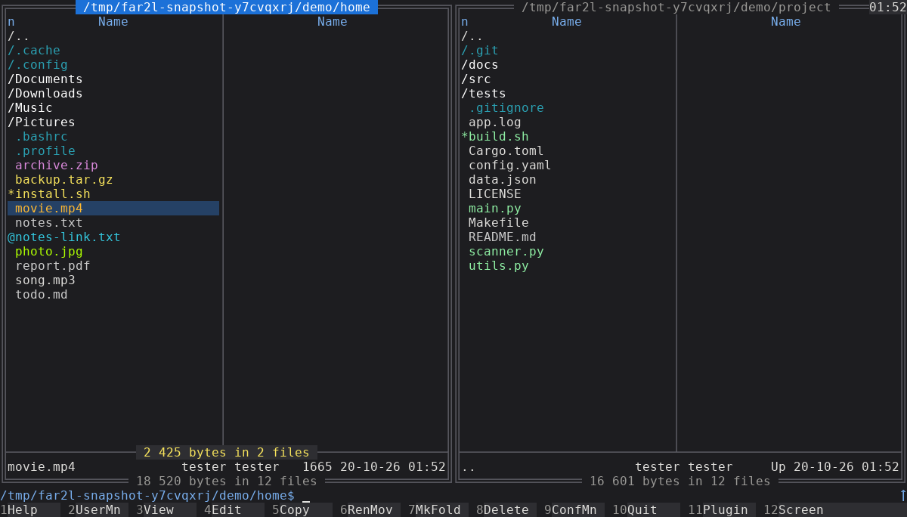
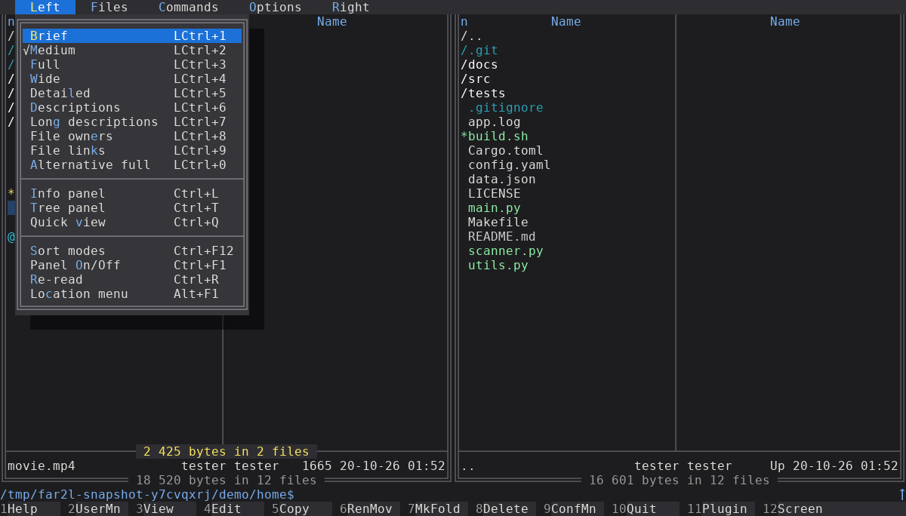
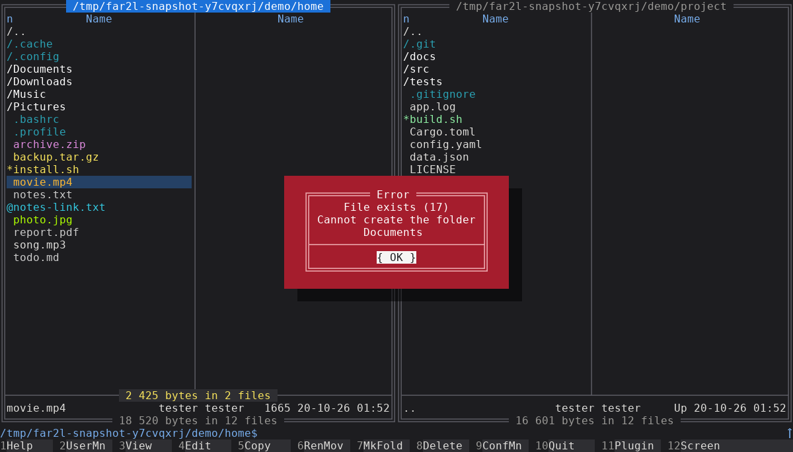
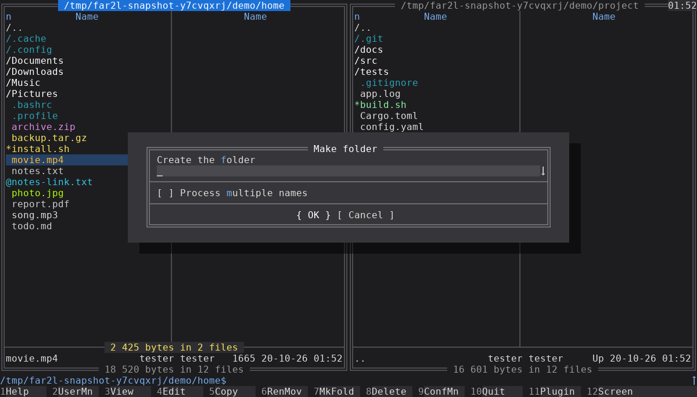
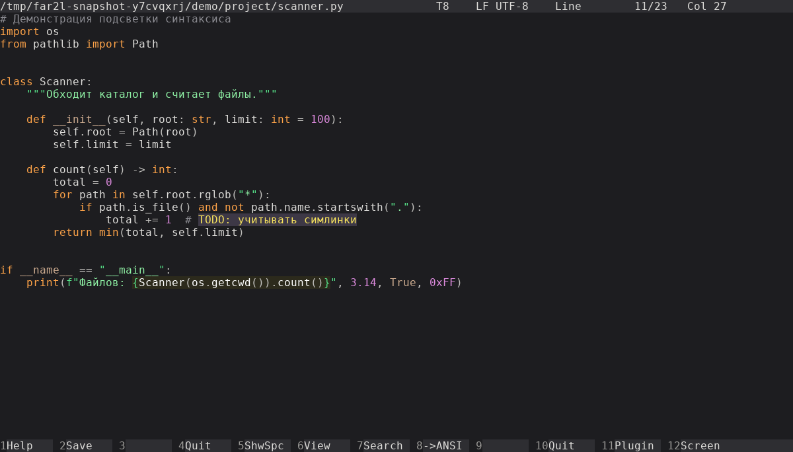

# far2l Dark Theme — «GNOME Graphite»

Очень тёмная графитовая тема для файлового менеджера [far2l](https://github.com/elfmz/far2l)
в цветах GNOME (libadwaita dark), плюс иконки приложения в том же стиле.
Один установщик для нескольких версий far2l и дистрибутивов: версию он определяет сам.



| Меню (F9) | Предупреждение |
|---|---|
|  |  |
| **Диалог (F7)** | **Редактор с подсветкой синтаксиса** |
|  |  |


## Проверенные окружения

| Окружение | far2l | Профиль | Статус |
|---|---|---|---|
| [Debian 12, GNOME, X11](environments/debian-12-gnome-x11-far2l-2.6/README.md) | 2.6.5 из `bookworm-backports` | [far2l-2.6](profiles/far2l-2.6/README.md) | проверено |
| [Fedora 44, GNOME, Wayland](environments/fedora-44-gnome-wayland-far2l-2.8/README.md) | 2.8.0 из COPR `polter/far2l` | [far2l-2.8](profiles/far2l-2.8/README.md) | проверено |

«Проверено» значит: `tools/e2e.py` в контейнере этого окружения ставит тему на чистый профиль,
проверяет её, снимает экраны графического и терминального режима, проверяет повторную установку
и откат. Другие дистрибутивы с far2l 2.6–2.8 тоже должны работать: от дистрибутива зависят
только пути и имена `.desktop`-файлов, а их установщик находит сам.

## Установка

```bash
git clone https://github.com/vabuter/far2l-dark-theme.git
```

```bash
cd far2l-dark-theme
```

Закройте far2l (F10): при сохранении настроек он перезаписал бы установленную тему.

```bash
python3 install.py
```

```bash
python3 install.py --verify
```

Установщик сам делает резервную копию настроек. Если far2l ещё ни разу не запускался, установщик
запустит его в tmux и закроет, чтобы появились штатные настройки. Что он нашёл, можно посмотреть
заранее, ничего не меняя: `python3 install.py --detect`.

**Требования:** far2l 2.6.5 или новее, Python 3.8+. Желательно tmux: без него на совсем новой
установке far2l придётся один раз запустить вручную. Права root не нужны: всё ставится
в домашний каталог.

## Что меняется

| Часть | Что меняется | Файл в репозитории |
|---|---|---|
| Цвета интерфейса | панели, меню, диалоги, редактор, просмотрщик, справка | `theme/farcolors.ini` (генерируется из `far2l_theme/colors.py`) |
| Базовая палитра | 16 цветов: типы файлов, вывод команд во встроенном терминале | `theme/palette.ini` |
| Раскраска файлов | цвет файла под курсором = его обычный цвет | — |
| Подсветка синтаксиса | схема Colorer `graphite` для встроенного редактора | `theme/graphite.hrd` |
| Иконки | far2l и редактор far2l, включая ярлыки «(Terminal)» | `icons/*.svg` |

Куда пишутся цвета, зависит от версии far2l:

- **2.8 и новее** — пользовательская тема `settings/themes/GNOME Graphite/farcolors.ini`,
  выбранная в `[Colors] CurrentTheme`;
- **2.6–2.7** — тем в far2l ещё нет, цвета пишутся в `settings/farcolors.ini`
  (тема тоже пишется — пригодится после обновления far2l).

Всё лежит в каталоге настроек far2l (`$FARSETTINGS/.config`, иначе `$XDG_CONFIG_HOME/far2l`,
иначе `~/.config/far2l`). Иконки и `.desktop`-файлы — в `~/.local/share`. Системные файлы
в `/usr` не меняются.

## Откат

Полный откат к состоянию до установки — копией, которую установщик в конце называет
«откат к виду до темы» (последняя копия без темы; копии повторных запусков уже содержат тему):

```bash
python3 install.py --restore ~/.config/far2l-backup-ГГГГММДД-ЧЧММСС.tar.gz
```

Текущие настройки при этом не удаляются, а откладываются в `~/.config/far2l.replaced-…`.

На far2l 2.8 тему можно сменить прямо в программе: F9 → Параметры → Цвета.

## Свои цвета

Цвета интерфейса и палитра — константы в [far2l_theme/colors.py](far2l_theme/colors.py),
цвета подсветки синтаксиса в редакторе — в [theme/graphite.hrd](theme/graphite.hrd) (фон строк там
тоже задан, держите его равным `BG`). Поменяйте их и запустите `python3 install.py` ещё раз.
Чтобы обновить готовые файлы в репозитории:

```bash
python3 install.py --export theme
```

## Проверка без экрана

Снимки far2l на копии настроек: графическое окно в Xvfb или терминальный режим в tmux.

```bash
python3 tools/snapshot.py --out /tmp/far2l-shots
```

Тесты:

```bash
python3 -m unittest discover -s tests
```

Сквозная проверка во всех окружениях (нужен только podman или docker, остальное — в контейнерах):

```bash
python3 tools/e2e.py
```

## Для ИИ-агентов

Пошаговая инструкция по установке, проверке и решению проблем — в [AGENTS.md](AGENTS.md).

## Структура

```
install.py          установщик: --detect, --verify, --restore, --export
far2l_theme/        общая логика: цвета (colors.py), определение версии, шаги, проверка
profiles/           что отличается между версиями far2l: куда писать цвета, имена цветов
environments/       проверенные окружения: особенности, Containerfile для проверки, снимки
theme/              общие файлы темы: farcolors.ini, palette.ini, graphite.hrd
icons/              иконки far2l и редактора far2l
tools/              snapshot.py (снимки экранов), shotcheck.py (проверка цветов на них), e2e.py (проверка в контейнерах)
tests/              модульные тесты
```
