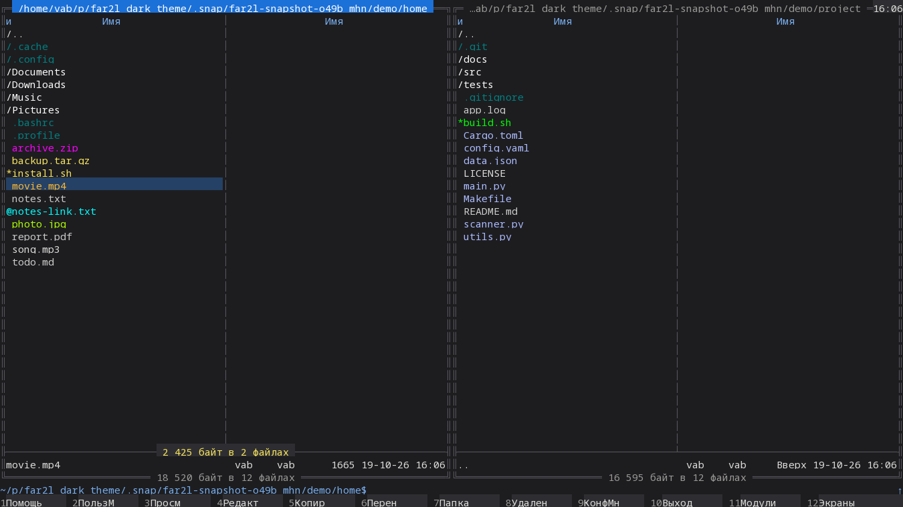
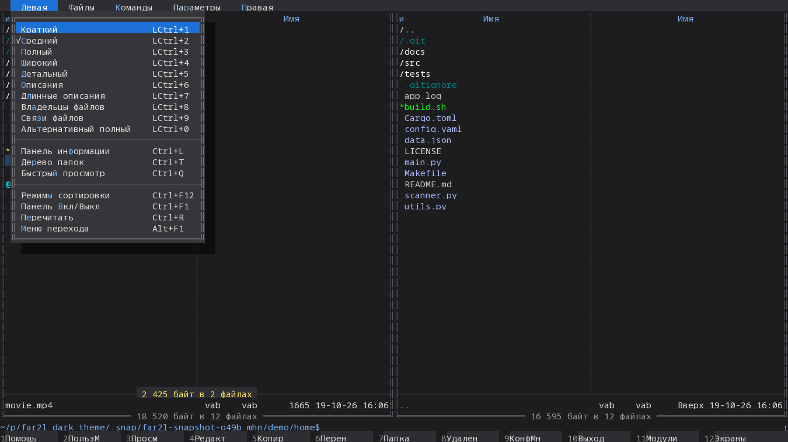
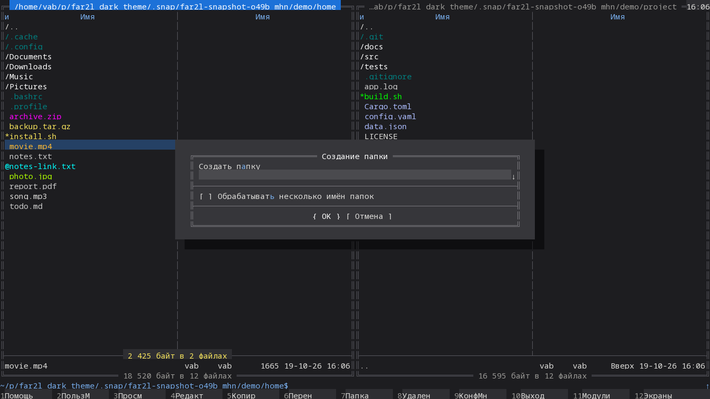
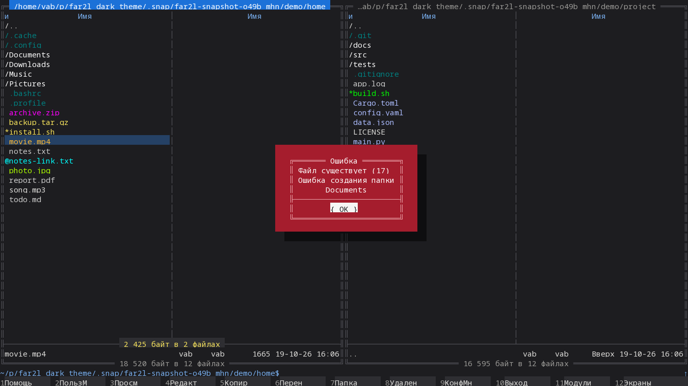
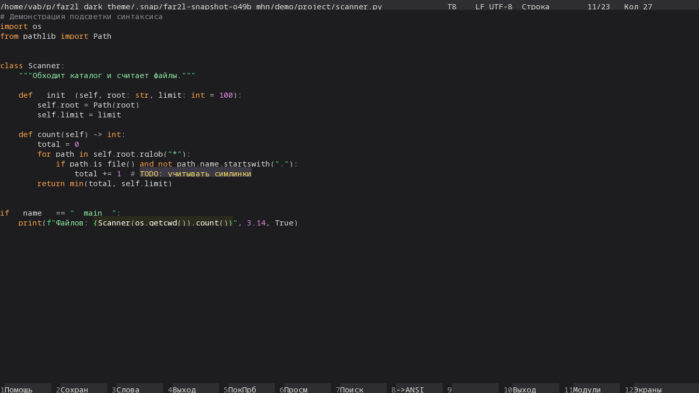
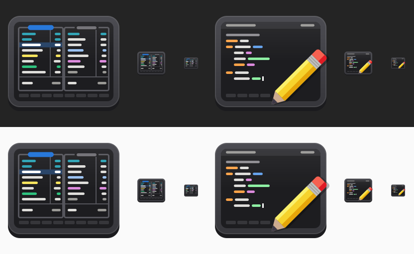

# far2l Dark Theme — «GNOME Graphite»

Очень тёмная графитовая тема для файлового менеджера [far2l](https://github.com/elfmz/far2l)
в цветах GNOME (libadwaita dark), плюс иконки приложения в том же стиле.



| Меню (F9) | Диалог (F7) |
|---|---|
|  |  |
| **Предупреждение** | **Редактор с подсветкой синтаксиса** |
|  |  |



## Что входит

| Часть | Что меняется | Файл в репозитории |
|---|---|---|
| Тема интерфейса | панели, меню, диалоги, редактор, просмотрщик, справка (160 цветов) | `theme/farcolors.ini` |
| Базовая палитра | 16 цветов, через которые рисуются типы файлов и вывод команд во встроенном терминале | `theme/palette.ini` |
| Раскраска файлов | цвет файла под курсором = его обычный цвет (штатные рассчитаны на бирюзовый курсор) | — |
| Подсветка синтаксиса | схема Colorer `graphite` для встроенного редактора | `theme/graphite.hrd` |
| Иконки | far2l и редактор far2l, только для текущего пользователя | `icons/*.svg` |

Основные цвета: фон `#1d1d20` (фон списка файлов в «Файлах» GNOME), акцент `#1c71d8`,
курсор `#254165`, текст `#deddda`, отмеченные файлы `#f8e45c`.

## Установка

```bash
git clone https://github.com/vabuter/far2l-dark-theme.git
cd far2l-dark-theme
```

Закройте far2l (F10). При выходе он сохраняет настройки и перезаписал бы установленную тему.

```bash
python3 install.py
```

```bash
python3 install.py --verify
```

Установщик сам делает резервную копию настроек. Если far2l на машине ещё ни разу не запускался,
установщик сам запустит его в tmux и закроет, чтобы появились штатные настройки.

**Требования:** far2l с поддержкой тем (2.6 и новее, проверено на 2.8.0), Python 3.8+.
Желательно tmux (первичная настройка чистого far2l и снимки экрана), для PNG-снимков нужен Pillow.
Права root не нужны: всё ставится в домашний каталог.

## Что именно меняет установщик

В каталоге настроек far2l (`$FARSETTINGS/.config`, иначе `$XDG_CONFIG_HOME/far2l`, иначе `~/.config/far2l`):

- `settings/themes/GNOME Graphite/farcolors.ini` — новая пользовательская тема;
- `settings/colors.ini` — `[Colors] CurrentTheme=GNOME Graphite` и цвет под курсором в группах раскраски;
- `palette.ini` — базовая палитра;
- `plugins/colorer/` — `graphite.hrd`, `user-hrd.xml` и 4 ключа в `config.ini` (`HrdNameTm`, `HrdName`, `UserHrdPath`, `TrueMod`).

В `~/.local/share` (только Linux):

- `icons/hicolor/scalable/apps/far2l-graphite.svg`, `far2ledit-graphite.svg`;
- `applications/far2l.desktop`, `far2ledit.desktop` — копии системных с другой строкой `Icon=`.

Системные файлы в `/usr` не меняются.

## Откат

Тему можно сменить прямо в far2l: F9 → Параметры → Цвета.

Полный откат к состоянию до установки (путь к копии установщик печатает при установке):

```bash
python3 install.py --restore ~/.config/far2l-backup-ГГГГММДД-ЧЧММСС.tar.gz
```

Текущие настройки при этом не удаляются, а откладываются в `~/.config/far2l.replaced-…`.

## Свои цвета

Все цвета — константы в начале [install.py](install.py). Поменяйте их и запустите `python3 install.py` ещё раз.
Чтобы обновить готовые файлы в репозитории: `python3 install.py --export theme`.

Посмотреть результат без графического экрана (far2l запускается в tmux на копии настроек):

```bash
python3 tools/snapshot.py --out /tmp/far2l-shots
```

## Для ИИ-агентов

Пошаговая инструкция по установке, проверке и решению проблем — в [AGENTS.md](AGENTS.md).

## Проверено

Fedora 44, GNOME, far2l 2.8.0 — графический режим (wx) и терминальный (TTY, TrueColor).
